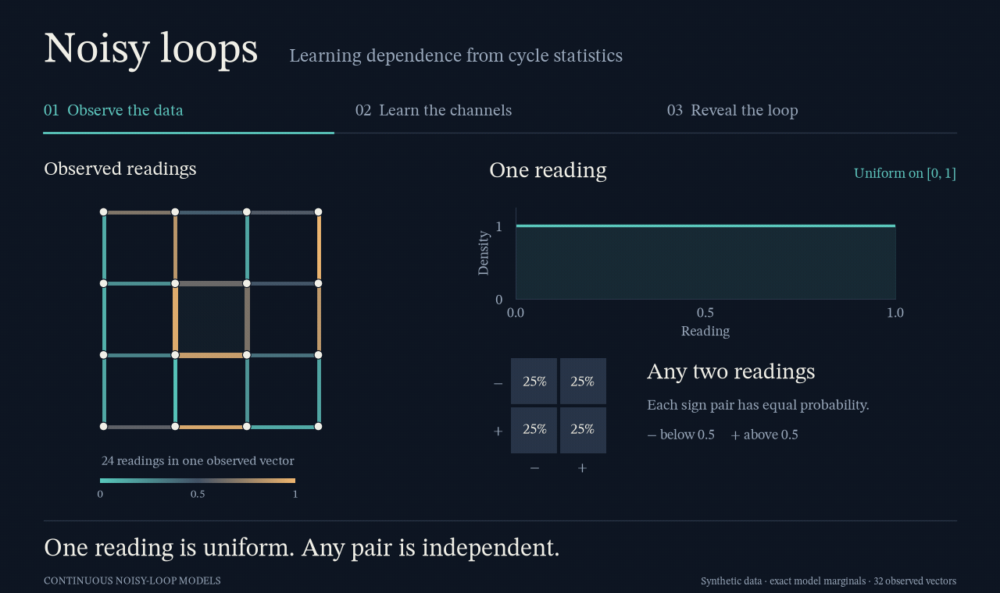

# Continuous Noisy-Loop Models

[](https://arxiv.org/abs/2611.24213)
[](#install)
[](LICENSE)

If every pair of readings is independent, how can three readings help predict a fourth?

Imagine flipping four fair coins independently, one at each corner of a square. A sensor on each edge gives a noisy reading of whether its two coins match. Going around the square, you must cross an even number of mismatches to get back to the face you started with. If the coins match along three edges, they must match along the fourth. Even with noise, three readings that favor a match make a match on the fourth edge more likely.

The same rule holds around every loop in a grid. In the model, the coin faces are hidden spins and each sensor returns a continuous value. Given the grid and unlabelled readings, the Python package fits the model, predicts missing readings and computes point densities or interval probabilities. [Paper](https://arxiv.org/abs/2611.24213) · [PDF](https://arxiv.org/pdf/2611.24213) · [Experiment guide](docs/reproduction.md)



The animation follows four fits from one seed as the training set grows from 8,192 to 524,288 vectors. The teal curves show how readings on the highlighted edges favor spin agreement (positive values) or disagreement (negative values). Each joint KL estimate uses 65,536 held-out vectors. Lower values mean a closer fit, and the intervals show ±1.96 Monte Carlo standard errors for each fit. “Independent” is the uniform product baseline.

In the final panel, the white outline tracks the observed signs. The fitted model assigns about 74% probability to an even number of negative signs, compared with 50% under independence.

## Install

The examples run on CPU with NumPy and SciPy. To use the versions pinned in the lockfile, install Python 3.12 or newer and [uv](https://docs.astral.sh/uv/getting-started/installation/).

```bash
git clone https://github.com/anindex/noisy_loop.git
cd noisy_loop
uv sync --locked
```

`uv run` uses the project environment automatically. To use the package in another uv project, run this from that project’s directory.

```bash
uv add "noisy-loop @ git+https://github.com/anindex/noisy_loop.git"
```

## Examples

Run these commands from the repository root.

```bash
uv run python -m examples.noisy_loop_exact
OMP_NUM_THREADS=1 uv run python -m examples.noisy_loop_fit
uv run python -m examples.noisy_loop_readout
```

| Example | What it shows |
|---|---|
| [Exact queries](examples/noisy_loop_exact.py) | On a 3×3 grid, the determinant and enumeration over all 512 spin states both give `0.979102657683`. The example also checks forest independence. |
| [Learning channels](examples/noisy_loop_fit.py) | Fits the channels from 8,192 synthetic vectors of 24 readings each. Cycle moments calibrate the channels and spline regression estimates their shapes. The example checks missing-reading and interval queries against positive row transfer. |
| [Measured readout](examples/noisy_loop_readout.py) | Predicts the first bond on a synthetic square using either its own reading or all four. The noise comes from measured superconducting-qubit readouts. |

The readout example uses data from Hanisch, Hetényi and Wootton. Each measured pair contains the in-phase and quadrature (IQ) components of one readout. The example fits Gaussian channels to labelled pairs and draws from the held-out pairs to simulate readings on a square. The spline example learns its channels from unlabelled vectors. [Readout paper](https://arxiv.org/abs/2411.16228) · [Calibration protocol and data license](docs/reproduction.md#example-data)

On that square, predicting the first bond from its own reading gives a log loss of 0.045615 nats per bond. Using all four readings lowers it to 0.015850. The example checks the posterior against spin enumeration and the determinant gradient.

## Fit and query

```python
from noisy_loop import PlanarBondSpline, fit_blocks, log_block_evidence, sample_loop

train = sample_loop(side=4, target='ramp', eta=0.83125, n=8192, seed=1)
test = sample_loop(side=4, target='ramp', eta=0.83125, n=1024, seed=2)
nodes, diagnostics = fit_blocks(train, side=4, cells=8, kappa=0.2, bound=0.98)
graph = PlanarBondSpline(4, 4)

log_density = log_block_evidence(graph, nodes, test, test)
lower, upper = test.copy(), test.copy()
lower[:, ::2], upper[:, ::2] = 0.0, 1.0
log_observed = log_block_evidence(graph, nodes, lower, upper)
log_conditional = log_density - log_observed
```

Each row is an independent observation vector. Columns follow `graph.edges`, with horizontal edges first. Equal bounds request a point density. Setting the bounds to `[0, 1]` integrates out that coordinate, and a narrower interval integrates over just that range. The last line gives the conditional log density of the even-indexed readings given the others, in nats per vector.

Use `target='ramp'` or `target='smooth'` and a positive integer sample count `n`.

| Argument | Paper notation | Meaning |
|---|---|---|
| `side` | $L$ | Vertices per side of a grid with $d=2L(L-1)$ edges |
| `cells` | $K$ | Linear-spline cells per channel |
| `bound` | $a_{\mathrm{in}}$ | Input amplitude cap, with $a\leq a_{\mathrm{in}}<1$ |
| `kappa` | $\kappa_{\mathrm{in}}$ | Positive input anchor, no greater than the true reliability lower bound |

`fit_blocks` requires `side >= 4`, at least four finite vectors in `[0, 1]`, and `0 < kappa < bound < 1`. By default it uses all training vectors for both short-cycle calibration and regression. It returns centered, bounded estimates of the identifiable scalar channels and two-coordinate corner products. The diagnostics include feasibility residuals and a primal-dual projection gap.

## Scope and numerical limits

Fitting assumes a known square grid, known uniform margins and independent uniform latent spins. Under these assumptions, readings on any forest of edges are independent. The implemented spline fit requires a positive reliability lower bound. The paper derives the anchor-free rate with a separate finite-net estimator.

`PlanarBondSpline` also answers queries for known ramp channels on rectangular grids with a user-supplied, fixed zero-field Ising prior. For fitted channels, `log_block_evidence` requires independent latent spins.

The determinant uses floating-point sparse LU. If the readings strongly favor incompatible bonds, the forward error can be large even when the phase and posterior-range checks pass. The paper counts exact arithmetic operations and leaves bit complexity open. For a difficult query on a small grid, positive row transfer in `noisy_loop.planar_bond_transfer` provides an independent check. Its cost grows exponentially with grid width, and it accepts at most 24 columns.

## Checks

```bash
OMP_NUM_THREADS=1 uv run pytest -q
```

The tests compare likelihoods, gradients and conditional scores with spin enumeration and positive row transfer. They check projection gaps against an independent quadratic program and cover calibration, normalization, sampling and the experiment commands.

## Citation

If you find the code or examples useful in your research, please consider citing the paper.

An T. Le. *Continuous Noisy-Loop Models*. arXiv:2611.24213 [cs.LG], November 18, 2026. [DOI](https://doi.org/10.48550/arXiv.2611.24213)

```bibtex
@misc{le2026continuousnoisyloopmodels,
  author        = {An T. Le},
  title         = {Continuous Noisy-Loop Models},
  year          = {2026},
  eprint        = {2611.24213},
  archivePrefix = {arXiv},
  primaryClass  = {cs.LG},
  doi           = {10.48550/arXiv.2611.24213},
  url           = {https://arxiv.org/abs/2611.24213}
}
```

## License

The code is licensed under [Apache 2.0](LICENSE). The measured IQ data retain their [MIT license](examples/data/LICENSE) and [original attribution](NOTICE).
